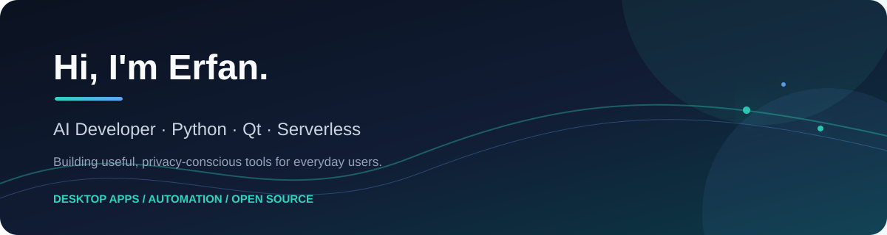

<div align="center">



</div>

<h1 align="center">Erfan · AI Developer</h1>

<p align="center">
  I build useful desktop applications, serverless tools and AI-assisted products — with a focus on privacy, clarity and real-world utility.
</p>

<p align="center">
  <a href="https://github.com/erfan138057?tab=repositories"></a>
  <a href="https://github.com/erfan138057/rss-reader-app"></a>
  <a href="https://x.com/Erfan_rs2001"></a>
</p>

## What I build

I enjoy turning practical ideas into focused products. My current work spans privacy-first desktop software, Persian-friendly tools, serverless backends, messaging automation and experiments at the intersection of software and AI.

## Featured projects

| Project | What it does |
| --- | --- |
| [RSS Reader Pro](https://github.com/erfan138057/rss-reader-app) | A modern PySide6 RSS reader for Windows and Linux with Reader Mode, OPML, advanced search, bookmarks, local-first storage and direct video playback. |
| [Bale Hermes](https://github.com/erfan138057/bale-hermes) | Tools and experiments for building useful workflows around the Bale messenger ecosystem. |

## Tech I use

<p>
  
  
  
  
  
  
</p>

## Principles

- **Useful over flashy:** every feature should solve a real problem.
- **Privacy by default:** local-first storage and transparent data behavior matter.
- **Small, shippable steps:** build, test, release and learn from real usage.
- **Open source where it helps:** share the parts that can help other developers.

## Connect

- GitHub: [@erfan138057](https://github.com/erfan138057)
- X: [@Erfan_rs2001](https://x.com/Erfan_rs2001)
- Open to conversations about desktop apps, Python, Qt, serverless tools and automation.

## Support my work

If one of my projects has been useful to you, you can support continued development through [Daramet](https://daramet.com/erfan138057) or TON / Tonkeeper:

```text
UQDxij8m9bvUyGqEwEUfY5afFi16rqdQo7fnsuKO0trJjBrS
```

<div align="center">

Thanks for stopping by.

</div>
